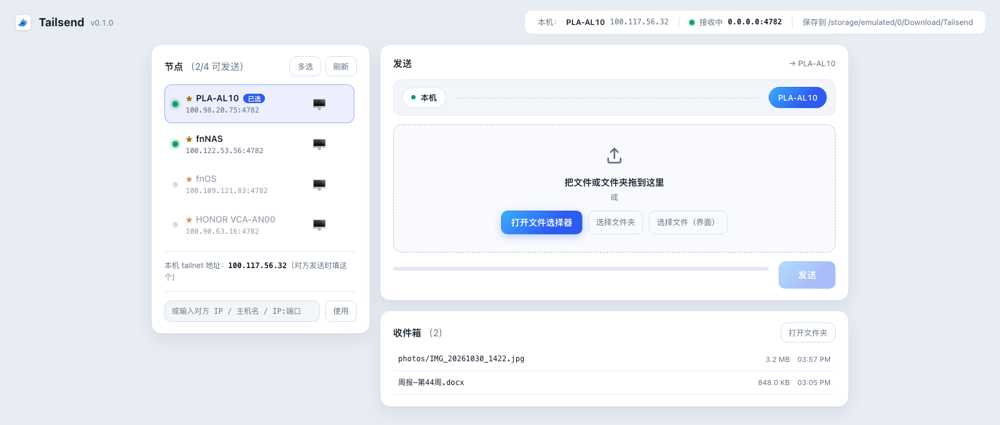
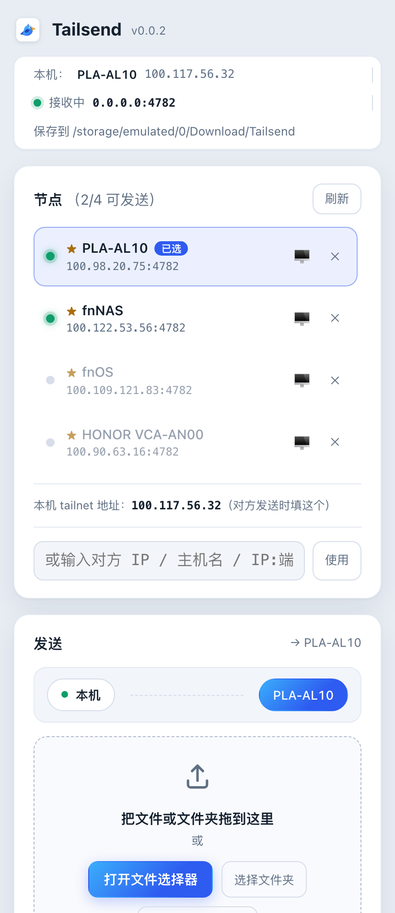

# Tailsend App（Tauri 2）

Tailsend 的图形界面版：桌面 + 手机，一套 Rust 核心。

| 桌面 | 手机 |
|---|---|
|  |  |

```
┌────────────── ui/（HTML/CSS/JS，无打包器）──────────────┐
│  节点列表 · 拖拽/选择文件 · 队列与进度 · 收件箱           │
└────────────── invoke / event ───────────────────────────┘
┌──────────── src-tauri/src/（Rust 核心）─────────────────┐
│  discovery.rs  读 tailscale status、解析目标             │
│  netcore.rs    HTTP :4782 接收端 + multipart 发送        │
│  state.rs      接收端生命周期（含断线自动重试）           │
│  commands.rs   Tauri 命令（界面 ↔ 核心）                 │
│  selftest.rs   --selftest：无界面跑同一套收发逻辑        │
└─────────────────────────────────────────────────────────┘
```

与根目录的 Go CLI **同一传输协议**，可互相收发文件。

## 前置条件：先安装 Tailscale

Tailsend 依赖 [Tailscale](https://tailscale.com) 组网传输，本身不自带 VPN——**每台要收发文件的设备都要先装好 Tailscale 并登录同一个 tailnet**：

- **桌面**：安装 [Tailscale 客户端](https://tailscale.com/download) 并保持连接。节点发现需要 `tailscale` 命令行（Linux/Windows 官方包自带；macOS App Store 版会自动定位应用内置 CLI，无需配置）。
- **手机**：装 Tailscale App 并连接（系统 VPN 图标亮起）。手机上没有 CLI，节点发现不可用——用「收藏目标」：输入一次对方 IP，之后自动记住、探测在线状态。
- **验证**：终端 `tailscale status` 能看到对方节点即就绪。没连上 Tailscale 时，Tailsend 的节点列表为空、接收端无法绑定 Tailscale IP（后台每 20 秒自动重试，连上即恢复）。

## 平台支持

| 平台 | 状态 | 说明 |
|---|---|---|
| macOS / Windows / Linux | ✅ 已验证 | 拖拽 + 原生文件选择器，无大小限制 |
| Android 10+ | ✅ 已发布 | armv8 / armv7 签名 APK，minSdk 24 |
| iOS | 🧱 已适配 | 构建需 macOS + Xcode（见下） |

两端差异（移动端）：

- 手机读不到本机的 `tailscale` CLI，节点发现不可用 → 用**收藏目标**代替：手动输入过的地址会记住（★ 标记），并逐个探测 `/api/ping` 显示在线小灯，点 ✕ 取消收藏；发送成功的目标自动收藏；
- 移动端布局以**发送和收件箱为主**：节点列表收进发送卡片顶部的目标栏，点一下从下方落下浮层选择（同一套列表：小灯、★、手动输入都在里面），选完即收起；
- 接收端绑定 `0.0.0.0`（手机上拿不到 Tailscale IP），对方用本机列表里的手机 IP 即可发过来；手机自己的 tailnet 地址通过**探测对方**得知——接收端 `/api/ping` 会返回调用方 IP（`your_ip`，Go/Rust 双实现均已支持），第一次成功探测后显示在节点卡片下方；
- 「选择文件（界面）」走网页文件选择器 + 分块 IPC 传输，单文件上限 **1 GB**；桌面端「打开文件选择器」无限制。

## 桌面：构建与运行

依赖：[Rust](https://rustup.rs)、Node（只为 tauri CLI）、各平台 webview（macOS 内置）。

```bash
cd app
npm install            # 装 @tauri-apps/cli（也可以全局装）
npm run tauri dev      # 开发模式，热更新
npm run tauri build    # 出安装包：dmg / msi / deb / AppImage
```

调试二进制在 `src-tauri/target/debug/tailsend`，可直接运行。

无界面自测（和 Go 版互操作验证用的就是它）：

```bash
./src-tauri/target/debug/tailsend --selftest serve --port 4791 --dir /tmp/in
./src-tauri/target/debug/tailsend --selftest send 127.0.0.1:4792 ~/file.zip
./src-tauri/target/debug/tailsend --selftest peers
```

## 手机：构建

```bash
# Android（需 ANDROID_HOME + NDK + JDK 17；工程已 init 过，gen/android 就绪）
npm run tauri android dev                    # 连着手机/模拟器直接跑

# release 签名包（体积小，推荐）：先指定 keystore（gen/android 已配好从环境变量读取）
export TAURI_SIGNING_KEYSTORE_FILE="$HOME/.tailsend/release.keystore"
export TAURI_SIGNING_KEYSTORE_PASSWORD=…   TAURI_SIGNING_KEY_ALIAS=tailsend   TAURI_SIGNING_KEY_PASSWORD=…
npm run tauri android build -- --target aarch64 --apk   # armv8（64 位）；换成 armv7 出 32 位包
# 产物在 src-tauri/gen/android/app/build/outputs/apk/ 下，已签名可直接安装

# 不设上面变量时可出 debug 包（体积大，debug 签名，可直接安装）：
npm run tauri android build -- --target aarch64 --apk --debug

# iOS（需 macOS + Xcode）
npm run tauri ios init
npm run tauri ios dev          # 连着 iPhone/模拟器直接跑
npm run tauri ios build        # 出 Xcode 工程
```

手机上的本地网络权限（iOS 的 NSLocalNetworkUsageDescription、Android 的 INTERNET）`init` 时会生成好；第一次发送时系统会弹「本地网络」授权，允许即可。

## 界面说明

- **节点**：tailnet 节点列表，小灯三色语义——🟢 可发送（实测对方 Tailsend 接收端在运行，黄灯节点在线但对方没开 Tailsend）、🟡 在线但对方 Tailsend 未运行、⚪ 离线；上线即置顶并闪烁一次。「多选」打开后点选多个节点，文件会依次发给每个选中的目标（1:N）；★ 收藏的目标跨会话保留并实时探测；或手动输入 IP / 主机名 / `IP:端口`。
- **发送**：拖文件进来，或三种选择方式任一；队列逐个发送（大文件自动分块并行上传，见协议），链路条上有动画小包（尊重系统「减弱动态效果」设置）。
- **收件箱**：本机收到的文件列表，3 秒刷新，新到的文件高亮一瞬；「打开文件夹」直达保存目录；「令牌」为接收端设置共享密钥（与发送端的 `-token` 对应），改完自动重启接收端。
- 顶栏：本机名 + Tailscale IP、接收端状态（没起来时可点「重试」，后台每 20 秒也会自动重试——比如 Tailscale 是先开 App 后连上的）、保存目录。
